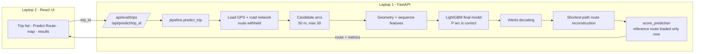

# PathSnap 🛰️🗺️
> **Map-matching noisy GPS trips to a road network and route reconstruction**

PathSnap reconstructs high-fidelity road routes from sparse, noisy GPS trajectory points (~1 Hz) by projecting geographic coordinates to metric UTM space, generating candidate road arcs, extracting geometric and sequence features, and decoding ground-truth trajectories.

---

## 1. Cross-Platform Environment Setup

Both **macOS** and **Windows** are fully supported. No C/C++ compiler is required on Windows; all dependencies use pre-built binary wheels.

### Automated Setup (Recommended)
From the repository root, run the cross-platform setup script with Python 3.10, 3.11, or 3.12:

```bash
# macOS / Linux
python3 setup_env.py

# Windows (PowerShell or CMD)
python setup_env.py
```
This automatically creates `.venv`, upgrades `pip`, installs `requirements.txt`, and installs `pathsnap` in editable mode (`pip install -e .`).

### Activation Commands

- **macOS / Linux (zsh or bash)**:
  ```bash
  source .venv/bin/activate
  ```
- **Windows (PowerShell)**:
  ```powershell
  .venv\Scripts\Activate.ps1
  ```
- **Windows (Command Prompt)**:
  ```cmd
  .venv\Scripts\activate.bat
  ```

---

## 2. Dataset Partitions & Leakage Governance

The benchmark comprises 100 trips in 3 partitions:
- **80 train** (`train`): Located in `data/raw/train/` (80 trip subdirectories `00000001` through `00000099`).
- **10 student-test** (`student_test`): Located in `data/raw/student_test/` (10 trip subdirectories `00000000`, `00000007`, `00000009`, `00000040`, `00000052`, `00000056`, `00000065`, `00000076`, `00000077`, `00000091`).
- **The evaluator 10 held by the organisers** (`evaluator_test`): We do not have the evaluator trips; they will be provided for the final evaluation demo only. The guard in `get_trips("evaluator_test")` is implemented for that future case to strictly withhold `.route` ground truth.

Partition names are uniformly standardized with underscores: `train`, `student_test`, and `evaluator_test`.

### Leakage Rules
1. **Strict Partition Disjointness**: A trip ID must never appear in more than one partition.
2. **Evaluator Isolation**: Evaluator data and `.route` ground truth labels must **NEVER** be used for training, feature extraction, model selection, or tuning.
3. **Student Code Isolation**: Evaluator ground truth must stay completely out of any student-side prediction code or UI.
4. **Preprocessing Guard**: All learned parameters (e.g. noise distributions, scalers, candidate thresholds) must be fit on training trips only.
5. **Programmatic Guard**:
   ```python
   from pathsnap.data.loader import get_trips

   # Safe: route labels are withheld by default for evaluator_test
   eval_trips = get_trips("evaluator_test", allow_evaluator_labels=False)
   ```

---

## 3. Dataset Inventory and Splitting

To scan raw trips, compute temporal/spatial statistics, and verify `configs/split.json`:

```bash
# Run inventory builder
python scripts/build_inventory.py

# Optional: purge cache before building
python scripts/build_inventory.py --clear-cache
```

Outputs:
- `outputs/inventory/trip_inventory.csv`: One row per trip with file sizes, point counts, time gaps, bounding box, network sizes, and fractional timestamp flags.
- `configs/split.json`: Strictly disjoint partitions (`train`, `student_test`, `evaluator_test`). Contains **trip IDs only** (zero labels).

---

## 4. Repository Directory Layout

```text
ML-Hackathon-PT-082/
├── configs/
│   ├── paths.yaml              # Central path configuration
│   └── split.json              # 80 train / 10 student_test / evaluator_test trip IDs
├── data/
│   ├── README.md               # Raw file format specifications and partition rules
│   ├── raw/                    # (Git-ignored) Local raw trip data (train/ and student_test/)
│   └── cache/                  # (Git-ignored) Version-invalidated serialized caches
├── docs/
│   └── data_quality_log.md     # Anomaly, projection, and data quality log
├── notebooks/                  # EDA, map visualizations, error analysis notebooks
├── outputs/
│   ├── inventory/              # trip_inventory.csv
│   ├── maps/                   # Trajectory overlays
│   ├── plots/                  # Visual evaluation plots
│   └── results/                # Evaluation metrics and experiments.csv
├── scripts/
│   └── build_inventory.py      # Scan dataset, compute stats, and manage split
├── src/
│   └── pathsnap/
│       ├── api/                # Future milestone: Serving & API endpoints
│       ├── data/               # loader.py, UTM projection, validation, caching
│       ├── features/           # Milestone 2: Geometric & sequence features
│       ├── hmm/                # Future milestone: HMM transition & emission decoders
│       ├── models/             # Milestone 2: Candidate ranking & scoring
│       └── utils/              # config.py, experiment_log.py
├── tests/                      # pytest test suite
├── .gitignore                  # Gitignore for raw data, caches, and build artifacts
├── pyproject.toml              # Modern Python packaging (pip install -e .)
├── requirements.txt            # Pinned cross-platform dependencies
├── setup_env.py                # Pure Python cross-platform venv setup
└── README.md                   # This document
```

---

## 5. Pipeline, Results and API

### Architecture



### Workflow (offline)


### Results (student-test, 10 trips, never used for training or selection)

| Stage | Result |
|---|---|
| Candidate scorers (grouped 5-fold CV Top-1, true arc among candidates) | Random Forest 0.846, MLP 0.843, LightGBM 0.843, Logistic Regression 0.840, KNN 0.823 — see `outputs/results/model_comparison.csv` |
| Final model | LightGBM, Bayesian-tuned (CV Top-1 0.8454); choice explained in [`docs/model_selection.md`](docs/model_selection.md) |
| ML only → ML + HMM, Top-1 over all GPS points | 0.856 → **0.876** |
| Consecutive predicted arcs connected | 0.924 → **0.996** |
| Reconstructed route vs true route (by length) | F1 **0.933**, precision 0.886, recall 0.990 |
| Prediction time per trip | 0.85 s mean, 1.9 s max |

### Reproduce

```bash
python scripts/build_feature_table.py                 # ~2-3 min, writes outputs/features/*.parquet
python -m pathsnap.models.train_logistic_regression   # likewise train_random_forest, train_knn, train_lightgbm, train_mlp
python -m pathsnap.models.compare                     # outputs/results/model_comparison.csv + figures
python -m pathsnap.models.bayesian_tune_lightgbm      # Optuna search (slow)
python scripts/export_final_model.py                  # artifacts/models/final_model.joblib (also committed)
python scripts/evaluate_pipeline.py                   # full pipeline on student_test
pytest -q
```

### API endpoints

Interactive docs: `http://<api-host>:8000/docs`.

| Method | Path | Returns |
|---|---|---|
| GET | `/api/health` | Status, whether the model file exists, evaluation partition and trip count |
| GET | `/api/eval/trips` | Trips of the evaluation partition (`evaluator_test`; `PATHSNAP_EVAL_PARTITION=student_test` for rehearsals) |
| GET | `/api/trips` | Train / student-test / evaluation trips available on the server |
| GET | `/api/trips/{trip_id}` | GPS points and network size of one trip (never the route) |
| POST | `/api/predict/{trip_id}` | Predicted route sections (`[[lat, lon], ...]`), GPS points, metrics (route F1 / precision / recall, points on route for ML + HMM and ML only), timing; cached per trip |

Evaluation trips go in `data/raw/evaluator_test/<trip_id>/` on the API laptop (git-ignored) with their IDs under
`evaluator_test` in `configs/split.json`. Prediction never reads `.route`; the API loads it afterwards only to compute
the metrics.

### Known limitations

* Viterbi transitions only distinguish same / connected / disconnected arcs (fixed penalties); they ignore road
  distance vs GPS distance and travel direction, and the penalties are untuned.
* Points with no arc within 50 m get no prediction (route section breaks); trips whose GPS is offset from the map
  (e.g. training trips 00000054, 00000033) score poorly.
* Balanced class weights inflate probabilities; Viterbi uses them as relative scores.
* GPS problems (gaps, implausible speeds, duplicates) are flagged, not removed; only gap flags affect decoding.

---

## 6. Two-Laptop Deployment (API on Laptop 1, UI on Laptop 2)

```bash
# Laptop 1 (API) - binds 0.0.0.0:8000 and prints its LAN address
python scripts/run_api.py

# Laptop 2 (UI) - point the UI at Laptop 1, then start it
cd frontend
cp .env.example .env.local      # set VITE_API_URL=http://<Laptop 1 IP>:8000
npm ci && npm run dev           # open http://localhost:5173  (or ...:5173/?api=http://<Laptop 1 IP>:8000)
```

Firewall rule, CORS options, pre-demo checks and troubleshooting: [`docs/deployment.md`](docs/deployment.md).
